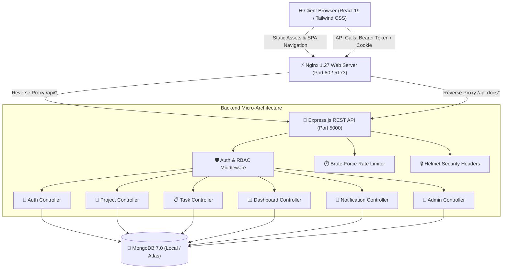

# TaskFlow — MERN Stack Project & Team Management Platform

[](https://github.com/your-username/taskflow/actions/workflows/ci.yml)
[](https://github.com/your-username/taskflow/actions/workflows/docker.yml)
[](LICENSE)
[](https://nodejs.org/)
[](https://react.dev/)
[](https://www.mongodb.com/)
[](http://localhost:5000/api-docs)

> **TaskFlow** is an enterprise-ready, full-stack software-as-a-service (SaaS) application designed for high-velocity engineering and product teams. It streamlines modern project planning, task orchestration, agile Kanban workflows, performance analytics, and administrative governance with production-grade reliability, containerization, and automated CI pipelines.

---

## 📌 Table of Contents
1. [Project Overview](#-project-overview)
2. [Key Features](#-key-features)
3. [Application Screenshots](#-application-screenshots)
4. [Technology Stack](#-technology-stack)
5. [System Architecture](#-system-architecture)
6. [Prerequisites & Installation](#-prerequisites--installation)
7. [Demonstration Credentials](#-demonstration-credentials)
8. [Environment Variables](#-environment-variables)
9. [Running Locally](#-running-locally)
10. [Running with Docker](#-running-with-docker)
11. [Swagger / OpenAPI Documentation](#-swagger--openapi-documentation)
12. [Automated Testing Suite & Results](#-automated-testing-suite--results)
13. [GitHub Actions CI/CD Pipelines](#-github-actions-cicd-pipelines)
14. [Production Deployment Guide](#-production-deployment-guide)
15. [Security Architecture & Audit Checklist](#-security-architecture--audit-checklist)
16. [Known Limitations & Future Roadmap](#-known-limitations--future-roadmap)
17. [License](#-license)

---

## 📖 Project Overview

Modern software teams often struggle with fragmented project tools, inconsistent permission models, slow status updates, and lack of workload transparency. **TaskFlow** solves this by consolidating the entire project lifecycle into a cohesive, responsive web platform:

- **Unified Agile Workflow**: Transition ideas from planning to backlog, execution, review, and completion on interactive Kanban boards.
- **Role-Gated Security**: Tailored interfaces and API access controls for regular contributors (`USER`), technical leaders (`PROJECT_MANAGER`), and system administrators (`ADMIN`).
- **Real-Time Visibility**: Live metric aggregation, overdue deadline flags, velocity charts, and activity audit streams.
- **Enterprise Engineering Standards**: Comprehensive automated testing (146 tests), OpenAPI 3.0 documentation, multi-stage Docker images, and GitHub Actions CI pipelines.

---

## ✨ Key Features

### 🔐 1. Authentication & User Management (Phase 2)
- **Dual-Strategy Token Delivery**: JWT authentication delivered via HTTP-Only, SameSite cookies and optional Authorization Bearer headers for cross-origin flexibility.
- **Role-Based Access Control (RBAC)**: Backend middleware (`requireRole`) and React route guards (`RoleRoute`, `ProtectedRoute`) restricting views and API mutations across `USER`, `PROJECT_MANAGER`, and `ADMIN`.
- **Bcrypt Hashing**: 10 salt rounds with pre-save Mongoose hooks ensuring plain-text passwords are never stored or logged.
- **User Profile Management**: Self-service profile updates, password modification, and session status verification.

### 📁 2. Project Management & Portfolios (Phase 3)
- **Full Project CRUD**: Create, inspect, update, and archive projects with strict manager validation.
- **Team Collaboration**: Add and remove project collaborators with duplicate detection and user search.
- **Leadership Delegation**: Seamlessly reassign project managers among team members without privilege escalation.
- **Search, Filter & Sorting**: Debounced full-text search across titles and descriptions; filter by status and priority; sort by date and alphabet with server-side pagination.

### 📋 3. Task Management & Agile Kanban Board (Phase 4)
- **Interactive Kanban Board**: 4-column drag-and-drop board (`TODO`, `IN_PROGRESS`, `IN_REVIEW`, `DONE`) powered by `@hello-pangea/dnd`.
- **Optimistic UI Updates**: Instant fluid drag feedback on the board with automatic rollback on network failure.
- **Task Assignment & Overdue Detection**: Assign tasks to contributors; dynamic derivation of overdue status (`dueDate < now && status !== DONE`) with visual warning badges.
- **Discussion Threads**: Timestamped task comments with author metadata and deletion authorization.

### 📊 4. Dashboard Analytics & Visualizations (Phase 5)
- **Real-Time Aggregations**: Total projects, active projects, task counts, completion velocity, and overdue tasks computed directly with MongoDB facet aggregation pipelines.
- **Interactive Visualizations (Recharts)**:
  - **Task Status Donut Chart**: Breakdown across `TODO`, `IN_PROGRESS`, `IN_REVIEW`, and `DONE`.
  - **Project Pipeline Bar Chart**: Distribution across `PLANNING`, `ACTIVE`, `ON_HOLD`, `COMPLETED`, `CANCELLED`.
  - **Completion Velocity Area Chart**: Tasks completed over time (`Daily`, `Weekly`, `Monthly` views).
- **Upcoming Deadlines**: Real-time sorted list of pending deadlines with direct task navigation.
- **Recent Activity Stream**: Live audit log of project and task lifecycle events with user avatars.

### 🔔 5. In-App Notifications & Activity Center (Phase 6)
- **Database-Backed Notifications**: Indexed collection storing recipient, trigger type, related entities, read status, and links.
- **Trigger Events**: `TASK_ASSIGNED`, `TASK_STATUS_CHANGED`, `TASK_COMPLETED`, `TASK_DUE_SOON`, `TASK_OVERDUE`, `PROJECT_ADDED`, `COMMENT_ADDED`.
- **Notification Services**: Sliding 5-minute event deduplication, user notification preferences, and self-action filtering.

### 🛡️ 6. Admin Dashboard & User Governance (Phase 7)
- **System-Wide Telemetry**: Total users, active accounts, suspended accounts, and role breakdown.
- **User Governance**: One-click role upgrades and demotions (`USER` ⇄ `PROJECT_MANAGER` ⇄ `ADMIN`).
- **Safety Protections**: Strict business guards preventing demotion or deletion of the last remaining platform administrator, and preventing deletion of active project managers.
- **Account Suspension**: Immediate login revocation and session invalidation for suspended accounts.

### 🧪 7. Automated Testing & API Documentation (Phase 8)
- **Swagger UI & OpenAPI 3.0**: Interactive documentation available at `/api-docs` and raw JSON specification at `/api-docs.json`.
- **Multi-Tier Testing**: 146 total tests across backend unit tests, Express API integration tests, 14-step E2E user journeys, and frontend logic suites.
- **Security Hardening**: Dedicated auth brute-force rate limiter (`50 req / 15 min`), 2MB body limit, and Helmet CSP policies.

### 🐳 8. Containerization & CI/CD Pipelines (Phases 9 & 10)
- **Multi-Stage Docker Architecture**: Non-root `node:22-alpine` backend and multi-stage `node:22-alpine` → `nginx:1.27-alpine` frontend.
- **Docker Compose**: Orchestrates MongoDB 7.0, Express API, and Nginx SPA with health-checked service dependencies.
- **Dual GitHub Actions Workflows**: Automated testing (`ci.yml`) and container Buildx verification (`docker.yml`).
- **Production Deployment Readiness**: Vercel SPA routing fallback (`vercel.json`), Render Web Service blueprint (`render.yaml`), and MongoDB Atlas connectivity.

---

## 🖼️ Application Screenshots

| Dashboard & Metrics | Interactive Kanban Board |
| :---: | :---: |
|  |  |
| *Real-time metrics, donut charts, and velocity trends* | *Fluid drag-and-drop with optimistic state rollback* |

| Project Portfolio & Table View | Admin Dashboard & User Management |
| :---: | :---: |
|  |  |
| *Search, status filters, pagination, and team management* | *System telemetry, role editing, and account suspension* |

> *To capture and link genuine application screenshots for your personal portfolio, run the app locally, take window screenshots, and place them in an `assets/screenshots/` folder.*

---

## 💻 Technology Stack

### Frontend Architecture
- **Framework**: React 19 (JavaScript ESModules)
- **Build Tool**: Vite 6.4
- **Routing**: React Router DOM v7 (Declarative protected routing)
- **Styling**: Tailwind CSS 3.4 & PostCSS
- **Component Icons**: Lucide React
- **Data Visualizations**: Recharts 2.15
- **Drag & Drop**: `@hello-pangea/dnd`
- **HTTP Client**: Axios with dual-strategy interceptors
- **Web Server (Production)**: Nginx 1.27 Alpine

### Backend Architecture
- **Runtime**: Node.js 22 LTS / Node.js 24
- **Web Framework**: Express.js 4.21
- **Database ODM**: Mongoose 8.12
- **Authentication**: JSON Web Tokens (`jsonwebtoken`) & `bcryptjs` (10 salt rounds)
- **Security Headers**: Helmet 8.0
- **Rate Limiting**: `express-rate-limit` (Global + Auth-specific limiters)
- **API Documentation**: Swagger UI Express 5.0 & OpenAPI 3.0.3
- **File Uploads**: Multer 1.4

### Database & Storage
- **Database Engine**: MongoDB 7.0 Community / MongoDB Atlas
- **Storage Volumes**: Docker named persistent volumes (`taskflow-mongo-data`, `taskflow-backend-uploads`)

### Testing & Quality Assurance
- **Backend Test Framework**: Jest 29.7 & Supertest 7.0
- **Frontend Test Framework**: Node.js 24 Native Test Runner (`node:test` & `node:assert/strict`)
- **Code Bundler Verification**: Vite Production Bundle Builder

### DevOps & Containerization
- **Container Engine**: Docker 29 & Docker Compose v5
- **Continuous Integration**: GitHub Actions (Ubuntu latest, Node 22, MongoDB Service container, Buildx)

---

## 🏗️ System Architecture



---

## 🚀 Prerequisites & Installation

### Prerequisites
- **Node.js**: v20.x or v22.x LTS ([Download](https://nodejs.org/))
- **npm**: v10.x or higher
- **MongoDB**: Local MongoDB community edition (Port 27017) OR a free [MongoDB Atlas](https://www.mongodb.com/atlas) connection URI
- **Docker & Docker Compose** *(Optional, for containerized run)*: [Docker Desktop](https://www.docker.com/products/docker-desktop/)

### Step-by-Step Local Setup

1. **Clone the repository**:
   ```bash
   git clone https://github.com/your-username/taskflow.git
   cd taskflow
   ```

2. **Install all dependencies**:
   ```bash
   # Install backend dependencies
   cd server
   npm ci

   # Install frontend dependencies
   cd ../client
   npm ci

   # Return to root
   cd ..
   ```

3. **Configure Environment Variables**:
   Copy `.env.example` to `server/.env` and `client/.env`:
   ```bash
   cp server/.env.example server/.env
   ```

4. **Seed Demonstration Data**:
   Populates demo accounts, sample projects, tasks across Kanban columns, activity items, and notifications:
   ```bash
   cd server
   npm run seed
   cd ..
   ```

---

## 🔑 Demonstration Credentials

The database seeder automatically configures three role-gated demonstration accounts:

| Role | Email | Password | Access Level |
|---|---|---|---|
| **Administrator** | `admin@taskflow.dev` | `Password123!` | System-wide admin dashboard, user role editing, account suspension, system telemetry |
| **Project Manager** | `pm@taskflow.dev` | `Password123!` | Portfolio management, project creation, member assignment, team analytics |
| **Regular Contributor** | `user@taskflow.dev` | `Password123!` | Assigned task execution, Kanban dragging, comments, personal notifications |

> *Tip: The web login page includes one-click "Quick Demo Fill" buttons for instant evaluation.*

---

## ⚙️ Environment Variables

### Backend (`server/.env`)
```ini
PORT=5000
NODE_ENV=development
MONGO_URI=mongodb://127.0.0.1:27017/taskflow
JWT_SECRET=super_secret_jwt_key_taskflow_dev_2026_change_in_production
JWT_EXPIRES_IN=7d
CLIENT_URL=http://localhost:5173
MAX_FILE_SIZE=5242880
UPLOAD_PATH=uploads
```

### Client (`client/.env`)
```ini
VITE_API_URL=/api
```

### Root / Docker (`.env.example`)
```ini
PORT=5000
NODE_ENV=production
MONGO_URI=mongodb://mongodb:27017/taskflow
JWT_SECRET=replace_with_secure_production_jwt_secret_key_minimum_32_chars
JWT_EXPIRES_IN=7d
CLIENT_URL=http://localhost:5173
MAX_FILE_SIZE=5242880
UPLOAD_PATH=uploads
VITE_API_URL=/api
FRONTEND_PORT=5173
BACKEND_PORT=5000
```

---

## 💻 Running Locally

### Option A: Local Node.js Development

```bash
# Terminal 1: Backend Server (Port 5000)
cd server
npm run dev

# Terminal 2: Frontend Client (Port 5173)
cd client
npm run dev
```

- **Frontend Application**: `http://localhost:5173`
- **Backend REST API**: `http://localhost:5000`
- **Health Check Endpoint**: `http://localhost:5000/api/health`
- **Swagger Documentation**: `http://localhost:5000/api-docs`

---

## 🐳 Running with Docker

TaskFlow provides a validated multi-container Docker Compose configuration:

```bash
# 1. Build and assemble images
docker compose build

# 2. Start services in background
docker compose up -d

# 3. Check container health status
docker compose ps

# 4. View aggregated real-time logs
docker compose logs -f

# 5. Stop services gracefully
docker compose down

# 6. Reset database volume (CAUTION: wipes persistent local database)
docker compose down -v
```

---

## 📖 Swagger / OpenAPI Documentation

When the backend is running, complete API documentation is available interactively:

| Resource | Route | Description |
|---|---|---|
| **Interactive Swagger UI** | [`http://localhost:5000/api-docs`](http://localhost:5000/api-docs) | Interactive testing sandbox for all 35+ REST endpoints |
| **OpenAPI 3.0.3 JSON Specification** | [`http://localhost:5000/api-docs.json`](http://localhost:5000/api-docs.json) | Machine-readable API schema for Postman / Swagger Codegen |
| **System Health Check** | [`http://localhost:5000/api/health`](http://localhost:5000/api/health) | Returns JSON status, uptime, and database connection state |

---

## 🧪 Automated Testing Suite & Results

### Test Execution Commands

```bash
# Run all tests across the entire workspace (Backend + Frontend)
npm test

# Run Backend Unit Tests (Validators, Auth logic, Admin guards)
npm run test:unit --prefix server

# Run Backend API Integration Tests (Auth, Projects, Tasks, Dashboard, Admin)
npm run test:integration --prefix server

# Run 14-Step End-to-End User Journey Tests
npm run test:e2e --prefix server

# Generate Backend Coverage Report
npm run test:coverage --prefix server

# Run Frontend Logic & Route Guard Tests
npm test --prefix client

# Build Frontend Production Bundle (Vite)
npm run build --prefix client
```

### Verified Test Results (146 Tests Passing)

```text
> server@1.0.0 test
PASS tests/notification.test.js
PASS tests/project.test.js
PASS tests/task.test.js
PASS tests/admin.test.js
PASS tests/auth.test.js
PASS tests/e2e/userJourneys.test.js
PASS tests/dashboard.test.js
PASS tests/unit/serviceUnit.test.js

Test Suites: 8 passed, 8 total
Tests:       127 passed, 127 total
Time:        4.685 s

> client@1.0.0 test
PASS tests/frontendLogic.test.js
  ▶ Registration Form Validation Logic (3 tests)
  ▶ Login Form Validation & Gating (2 tests)
  ▶ Route Guard & Authorization Decisions (4 tests)
  ▶ Navigation Visibility & Role-Based UI Rendering (3 tests)
  ▶ Notification Unread Count & Badge Display (3 tests)
  ▶ API Interceptor & Standard Error Normalizer (2 tests)
  ▶ Kanban Status & Priority Integrity (2 tests)
Tests:       19 passed, 19 total
Time:        138 ms
```

---

## 🚀 GitHub Actions CI/CD Pipelines

TaskFlow automates quality control with two GitHub Actions workflows in `.github/workflows/`:

1. **Continuous Integration Pipeline (`.github/workflows/ci.yml`)**:
   - **Triggers**: Pushes and Pull Requests targeting `main`, `master`, and `develop`.
   - **Backend Job**: Starts a real MongoDB 7.0 container service, runs `npm ci`, executes unit tests, executes integration tests, executes 14-step E2E user journeys, generates coverage reports, and uploads coverage artifacts.
   - **Frontend Job**: Runs `npm ci`, executes frontend validation tests, and builds the production Vite bundle.

2. **Docker Image Build & Verification (`.github/workflows/docker.yml`)**:
   - **Triggers**: Pushes and PRs modifying `server/**`, `client/**`, `docker-compose.yml`, or Dockerfiles.
   - Statically validates `docker-compose.yml` via `docker compose config`.
   - Utilizes Docker Buildx with GitHub Actions layer caching (`type=gha`) to build and verify both backend and frontend images without publishing to a remote registry.

---

## 🌐 Production Deployment Guide

A recommended, battle-tested deployment architecture for TaskFlow:

- **Frontend**: Hosted on [Vercel](https://vercel.com) (Global CDN, automated SPA rewrites via `client/vercel.json`).
- **Backend**: Hosted on [Render](https://render.com) (Managed Node.js Web Service, auto-deploy via `render.yaml`).
- **Database**: Managed on [MongoDB Atlas](https://www.mongodb.com/atlas) (M0 Free Tier, automated backups).

### 1. MongoDB Atlas Setup
1. Log into [MongoDB Atlas](https://cloud.mongodb.com) and create an **M0 Free Cluster**.
2. Under **Database Access**, create a user (e.g. `taskflow_admin`) with the **Read and write to any database** role.
3. Under **Network Access**, click **Add IP Address** and choose **Allow Access from Anywhere** (`0.0.0.0/0`) so cloud application instances can connect.
4. Click **Connect** → **Drivers** and copy your connection URI:
   ```text
   mongodb+srv://taskflow_admin:<password>@cluster0.abcde.mongodb.net/taskflow?retryWrites=true&w=majority
   ```

### 2. Backend Deployment on Render
1. Create a free account on [Render](https://render.com).
2. Click **New +** → **Web Service** and connect your GitHub repository.
3. Configure service settings:
   - **Root Directory**: `server`
   - **Environment**: `Node`
   - **Build Command**: `npm ci`
   - **Start Command**: `node server.js`
   - **Health Check Path**: `/api/health`
4. Add Environment Variables:
   - `NODE_ENV`: `production`
   - `MONGO_URI`: `mongodb+srv://taskflow_admin:<password>@cluster0.abcde.mongodb.net/taskflow?retryWrites=true&w=majority`
   - `JWT_SECRET`: *(Generate a random 32+ character string)*
   - `JWT_EXPIRES_IN`: `7d`
   - `CLIENT_URL`: `https://your-taskflow-app.vercel.app` *(Your Vercel URL)*
5. Click **Create Web Service**. Once deployed, copy your backend URL (e.g. `https://taskflow-api.onrender.com`).

### 3. Frontend Deployment on Vercel
1. Create a free account on [Vercel](https://vercel.com) and click **Add New Project**.
2. Import your GitHub repository.
3. Configure project settings:
   - **Root Directory**: Click `Edit` and select `client`.
   - **Framework Preset**: `Vite`
   - **Build Command**: `npm run build`
   - **Output Directory**: `dist`
4. Add Environment Variable:
   - `VITE_API_URL`: `https://taskflow-api.onrender.com/api` *(Your Render backend URL + `/api`)*
5. Click **Deploy**. Vercel will build the frontend and serve it globally with SPA routing enabled via [`client/vercel.json`](client/vercel.json).

---

## 🛡️ Security Architecture & Audit Checklist

| Security Area | Implementation Details | Status |
|---|---|:---:|
| **Password Security** | Bcrypt with 10 salt rounds; pre-save hashing; plain-text passwords never stored or logged | ✅ Verified |
| **Authentication Strategy** | Dual-strategy JWT via HTTP-only, SameSite cookies and optional Authorization Bearer header | ✅ Verified |
| **Session Revocation** | Suspended accounts immediately blocked from logging in or querying protected endpoints | ✅ Verified |
| **Sole Admin Protection** | Demoting or deleting the final active platform administrator is strictly rejected (400 Bad Request) | ✅ Verified |
| **PM Deletion Guard** | Deleting any user who is the active manager of open projects is rejected until ownership is transferred | ✅ Verified |
| **Project Isolation** | Normal users cannot query, create tasks in, or modify projects they are not members of | ✅ Verified |
| **Notification Ownership** | Users can only query, mark as read, or delete notifications where `recipient === req.user._id` | ✅ Verified |
| **Brute-Force Rate Limiting** | Dedicated rate limiter (`50 req / 15 min`) on `/api/auth/login` and `/api/auth/register` | ✅ Verified |
| **Global Rate Limiting** | General API limiter (`300 req / 15 min`) preventing API flooding | ✅ Verified |
| **Request Body Hardening** | Body parser payload capped at `2mb` preventing memory exhaustion DoS attacks | ✅ Verified |
| **Security Headers** | Helmet middleware configured with cross-origin policies and CSP configured for Swagger UI | ✅ Verified |
| **CORS Origin Filtering** | Multi-origin allowlist with trailing slash normalization and Vercel preview matching | ✅ Verified |
| **Graceful Shutdown** | SIGTERM/SIGINT signal listeners closing HTTP server and MongoDB connections cleanly | ✅ Verified |
| **Database Sanitization** | Strict Mongoose schemas with enums, trimmed strings, and ObjectId regex validators | ✅ Verified |

---

## ⚠️ Known Limitations & Future Roadmap

1. **Distributed Rate Limiting**: The current rate limiter uses an in-memory store. In a multi-instance production cluster, rate limiting should be backed by a shared Redis instance (`rate-limit-redis`).
2. **WebSocket Real-Time Broadcasts**: While notifications and activities are database-backed and pollable, adding WebSocket / Socket.io live streaming would enable instantaneous cross-client updates.
3. **OAuth2 / SSO Integration**: Adding Google and GitHub OAuth providers would complement the existing JWT and cookie authentication system.
4. **Refresh Token Rotation**: Shortening access token lifespans to 15 minutes paired with rotating refresh tokens stored in HTTP-Only cookies would provide enhanced enterprise session security.

---

## 📄 License

This project is licensed under the terms of the [MIT License](LICENSE). You are free to use, modify, distribute, and build upon this software for personal and commercial projects.
